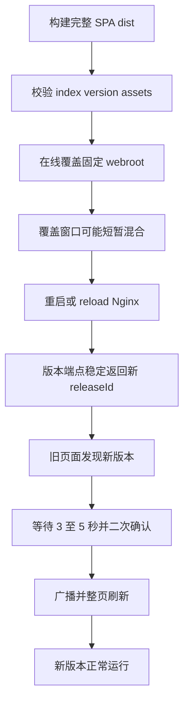

## Frontend Release Refresh（SPA 变体）

### Build And Runtime

- 构建时把同一 `releaseId` 固化到 SPA bundle，并在完整发布包中生成 `version.json`。
- `index.html`、`version.json`、hash JS/CSS/asset 必须来自同一次构建。
- `version.json` 使用 `no-store`；`index.html` 使用 `no-cache` 或 `no-store`；带内容 hash
  的 JS/CSS 使用长期 `immutable`。
- 动态 import / chunk 加载失败时先检查版本；只有确认服务端版本变化后才允许针对该版本刷新一次。

### Online Direct Overwrite

当现有运维流程是“在线直接覆盖固定 webroot，覆盖完成后重启或 reload Nginx”时：

- 项目接受覆盖窗口内短暂的新旧资源混合，不宣称零中断或原子发布。
- 版本信号必须尽量晚于主体文件复制；客户端仍必须等待 3 至 5 秒并二次确认，避免在覆盖中途刷新。
- 如果 `version.json` 随 dist 一起复制且无法保证最后写入，二次确认只能降低概率，不能形成严格原子保证。
- 发布完成后的目标是：旧页面发现稳定的新版本后整页刷新并恢复正常使用。
- 不要求使用多版本 release 目录、软链接或运维清理历史版本，除非运维另行批准。

