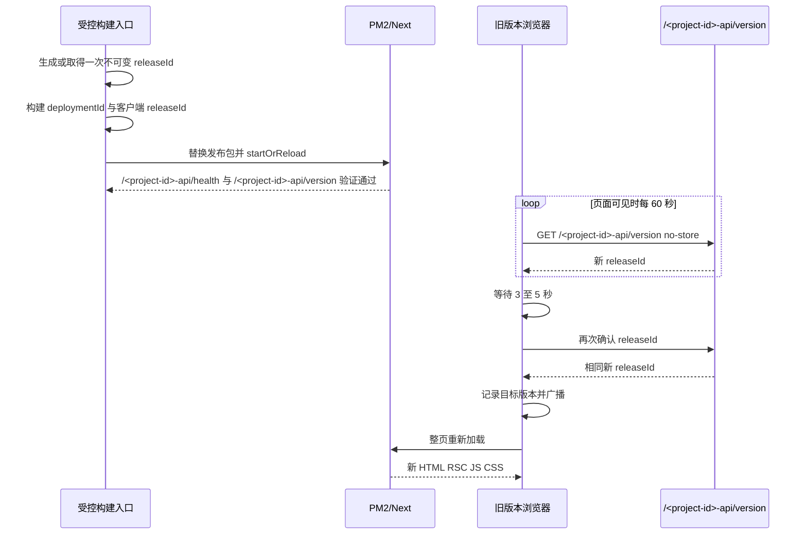

## Frontend Release Refresh（SSR 变体）

### Required Wiring

- `next dev` 不要求 `releaseId`，根布局不得挂载 VersionWatcher。
- 项目的标准构建入口必须在 `next build` 前准备好 `releaseId`。优先读取 CI/CD 注入值，否则由
  构建脚本生成；无论采用哪种方式，都只能生成或读取一次。
- `next.config` 的 `deploymentId` 使用该值，使 Next 在 RSC、静态资源和 Server Action 请求中
  处理版本偏斜。可通过 Next 原生 `NEXT_DEPLOYMENT_ID`、项目内部构建脚本或等价受控方式传递。
- 构建配置把同一值固化为客户端公开版本；根 Server Layout 将当前版本传给 VersionWatcher。
- 新增 release id fail-fast 校验时，必须同步修改标准构建脚本、CI/CD 接线和发布文档；不得让既有
  `build:<env>` 或线上发布命令依赖尚未配置、未记录的外部变量。
- 提供同源版本端点，例如 `/<project-id>-api/version`，只返回：

```json
{
  "releaseId": "20260821.abc123"
}
```

- 版本端点不调用后端、不读取用户会话、不进入 BFF gateway，响应必须包含：

```http
Cache-Control: no-store, max-age=0
```

### SSR Sequence



### Multi-Instance Boundary

- 同一批部署的所有实例必须使用相同 `releaseId`。
- 构建脚本自动生成只适用于“构建一次、分发同一份产物”的拓扑；多节点分别执行构建时，不得各自生成
  不同版本后混入同一服务池。
- 滚动发布期间，版本端点不得随机返回当前命中实例的新旧版本，否则客户端可能反复确认失败。
- 多机长期混跑或灰度发布时，版本端点必须返回“当前用户应使用的目标版本”，其事实源可来自
  发布平台、负载均衡 active slot 或现有配置中心。
- 不因为 SSR 或自动刷新单独引入 Nacos。只有公司已经使用 Nacos 且确实需要跨机器统一
  active release / 灰度规则时，才由服务端订阅并缓存；浏览器不得直接访问 Nacos。
