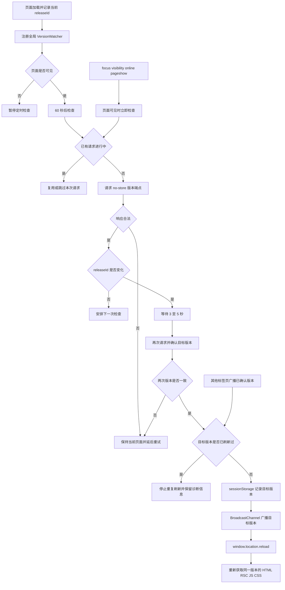
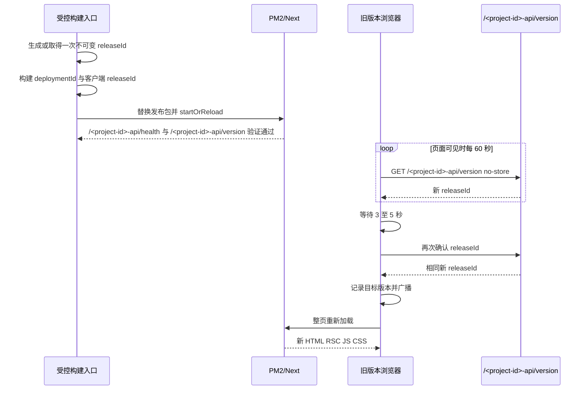

# Frontend Release Refresh

> 必读场景：SSR 或 SPA 需要在前端发版生效后自动整页刷新；自托管环境存在旧标签页、
> 动态 chunk、RSC、Server Action 或在线覆盖造成的新旧版本偏斜。

## Goals

- 发版产物使用一个不可变 `releaseId`，客户端只在确认服务端已稳定切换到新版本后刷新。
- 自动刷新使用整页重新加载，使 HTML、RSC、JS、CSS 与 Server Action 全部切到同一版本。
- 页面隐藏时停止定时检查；同一标签页只保留一个定时器和一个进行中的版本请求。
- 多标签页通过 `BroadcastChannel` 同步已经确认的新版本，避免分别等待下一轮检查。
- 版本检查失败、响应非法或版本不稳定时不刷新；同一目标版本最多自动刷新一次，避免循环。

## Release Identity

- 本规范中的 development / production 指 `NODE_ENV`。`NODE_ENV=development` 不要求 release id，
  不得因为缺少框架版本变量（SSR `NEXT_DEPLOYMENT_ID`、SPA `VITE_DEPLOYMENT_VERSION`）阻断本地启动。
- `releaseId` 必须由受控构建入口在框架构建开始前生成或取得，并在一次构建内保持不变。
- 单机构建后分发同一份产物时，可由构建脚本自动生成；多节点独立构建、滚动发布或灰度发布时，
  必须由 CI/CD、发布平台或统一事实源提供。
- 推荐使用环境、流水线号、Git SHA、UTC 构建时间等非敏感信息组合，例如
  `prod.20260821.abc123`；具体格式由项目发布拓扑决定。
- 同一份发布产物内的入口页面、客户端 bundle、SSR 版本端点与框架部署标识必须使用同一个
  `releaseId`。
- `releaseId` 是公开诊断元数据，不得包含分支凭证、用户名、内网地址、token 或其他敏感信息。
- 禁止在请求处理、应用进程启动或浏览器运行期间重新生成版本号，否则同一份产物可能返回不同版本。
- 环境变量只是传递 `releaseId` 的一种实现方式，不得把自定义变量名写成所有项目的唯一接入契约。
- production 构建优先使用 CI/CD 注入的框架版本变量（SSR `NEXT_DEPLOYMENT_ID`、SPA
  `VITE_DEPLOYMENT_VERSION`）；未注入时由标准构建脚本自动生成。
  release id 不写入 `.env.*`，也不作为 development 启动前置条件。

## Client Detection State Machine



## Client Runtime Rules

- VersionWatcher 只在 production 构建中挂载；development 不轮询版本端点，不触发发版整页刷新。
- 全站只能挂载一个 VersionWatcher；SSR 放在根 Provider，SPA 放在应用根组件。
- 每个可见标签页每 60 秒检查一次；隐藏标签页清除定时器，恢复可见时立即检查。
- 使用递归 `setTimeout`，必须等待本次请求完成后再安排下一次；禁止固定 `setInterval`
  产生重叠请求。
- 同一时刻最多一个版本请求；请求必须设置超时并在组件卸载时取消。
- 首次发现新版本后等待 3 至 5 秒，再请求一次；仅当两次结果相同才允许刷新。
- 请求失败、HTTP 非成功、JSON 非法、缺少 `releaseId` 或两次版本不一致时不刷新。
- 使用 `sessionStorage` 记录最后一次刷新目标；刷新后仍运行旧版本时，不得针对同一目标无限刷新。
- `BroadcastChannel` 只广播已经完成二次确认的版本。浏览器不支持时允许退化为各标签页独立检查。
- `router.refresh()` 只用于刷新 RSC 数据，不满足发版切换；发版必须使用
  `window.location.reload()` 或等价整页导航。

## Cache And Proxy

- Nginx、网关和 CDN 不得缓存 SSR `/<project-id>-api/version` 或 SPA `/version.json`。
- 版本端点必须同时下发：`Cache-Control: no-store, no-cache, must-revalidate, proxy-revalidate, max-age=0`、`Pragma: no-cache`、`Expires: 0`、`CDN-Cache-Control: no-store`、`Surrogate-Control: no-store`。
- SPA 静态 `version.json` 是可变的“当前版本指针”，CDN 缓存它会让发版检测永久滞后；CDN 控制台必须对精确路径设置 TTL=0/不缓存，而不是依赖文件扩展名或全局规则。
- SSR 版本端点必须 `dynamic = 'force-dynamic'`，Nginx 对版本 location 使用 `proxy_no_cache 1`、`proxy_cache_bypass 1`，并显式覆盖 `Cache-Control`。
- 查询参数只能作为额外防御，不能替代正确的响应缓存头与代理配置；每次请求带唯一参数（如 `?_=<timestamp>`）只能降低“同一 URL 被缓存”的概率。
- 发版后必须触发 CDN 刷新（URL 刷新精确到版本路径）；刷新有生效延迟，发布流水线不能假设立即生效。
- 发版后必须从公网入口验证响应头，而不只验证应用进程直连端口；至少检查 `Cache-Control`、`Age`、`X-Cache`/`CF-Cache-Status`、`Via`。
- 如果 CDN 无法对版本路径关闭缓存或刷新，前端无法单独保证及时刷新；必须改 CDN/网关配置，或把版本端点迁到明确不缓存的域名/路径。
- Next `/_next/static/**` 和 SPA hash assets 应保持内容寻址与长期缓存，不得被全局
  `Cache-Control: no-store` 覆盖。

## Failure Boundaries

- 版本端点不可用：保持当前页面，延后重试，不刷新。
- 首次与二次版本不同：视为发布尚未稳定，不刷新。
- 刷新后仍是旧版本：同一目标版本停止自动刷新，等待下一次不同版本或人工处理。
- 页面隐藏：停止定时请求；收到其他标签页已确认版本的广播时允许同步刷新。
- 浏览器不支持 BroadcastChannel：退化为每个可见标签页独立低频检查。
- 版本端点被 CDN 缓存：现象是发版后旧标签页长时间不刷新、`Age > 0` 或 `X-Cache: HIT`；先刷新 CDN，再检查缓存规则，不能只改前端 `fetch`。
- 自动刷新不能替代发布健康检查、回滚、静态资源缓存配置或 Server Action encryption key。

## Verification

- 单测覆盖：版本响应校验、60 秒递归检查、隐藏暂停、请求互斥、超时取消、二次确认、
  BroadcastChannel、sessionStorage 防循环。
- 构建入口验证：项目标准 `build:<env>` 命令在干净环境中可直接取得或生成合法 `releaseId`，不依赖
  未记录、未接线的外部变量。
- development 验证：不设置框架版本变量时 `dev:<env>` 可启动，且不会请求版本端点。
- SSR 构建验证：构建日志可定位本次 `releaseId`，且 `deploymentId`、客户端版本与
  `/<project-id>-api/version` 返回值一致。
- 发布后公网验证：健康检查成功、版本端点为新版本且 `no-store`、入口页面可加载、
  关键 JS/CSS 无 404。
- 缓存验证：公网版本端点 `Cache-Control` 含 `no-store`/`no-cache`、`Age` 为 0 或缺省、
  `X-Cache`/`CF-Cache-Status` 不是 `HIT`；建议用 `scripts/check-version-cache.mjs` 固化。
- 浏览器验证：旧版本标签页在检测周期内刷新；多个标签页同步刷新；后台标签页不持续轮询；
  网络失败或发布中版本不稳定时不产生刷新循环。

## Frontend Release Refresh（SSR 变体）

### Required Wiring

- `next dev` 不要求 `releaseId`，根布局不得挂载 VersionWatcher。
- 项目的标准构建入口必须在 `next build` 前准备好 `releaseId`。优先读取 CI/CD 注入值，否则由
  构建脚本生成；无论采用哪种方式，都只能生成或读取一次。
- `next.config` 的 `deploymentId` 使用该值，使 Next 在 RSC、静态资源和 Server Action 请求中
  处理版本偏斜。可通过 Next 原生 `NEXT_DEPLOYMENT_ID`、项目内部构建脚本或等价受控方式传递。
- 构建配置把同一值固化为客户端公开版本；根 Server Layout 将当前版本传给 VersionWatcher。
- 新增 release id fail-fast 校验时，必须同步修改标准构建脚本、CI/CD 接线和发布文档；不得让既有
  `build:<env>` 或线上发布命令依赖尚未配置、未记录的外部变量。
- 提供同源版本端点，例如 `/<project-id>-api/version`，只返回：

```json
{
  "releaseId": "20260821.abc123"
}
```

- 版本端点不调用后端、不读取用户会话、不进入 BFF gateway，响应必须包含：

```http
Cache-Control: no-store, max-age=0
```

### SSR Sequence



### Multi-Instance Boundary

- 同一批部署的所有实例必须使用相同 `releaseId`。
- 构建脚本自动生成只适用于“构建一次、分发同一份产物”的拓扑；多节点分别执行构建时，不得各自生成
  不同版本后混入同一服务池。
- 滚动发布期间，版本端点不得随机返回当前命中实例的新旧版本，否则客户端可能反复确认失败。
- 多机长期混跑或灰度发布时，版本端点必须返回“当前用户应使用的目标版本”，其事实源可来自
  发布平台、负载均衡 active slot 或现有配置中心。
- 不因为 SSR 或自动刷新单独引入 Nacos。只有公司已经使用 Nacos 且确实需要跨机器统一
  active release / 灰度规则时，才由服务端订阅并缓存；浏览器不得直接访问 Nacos。
